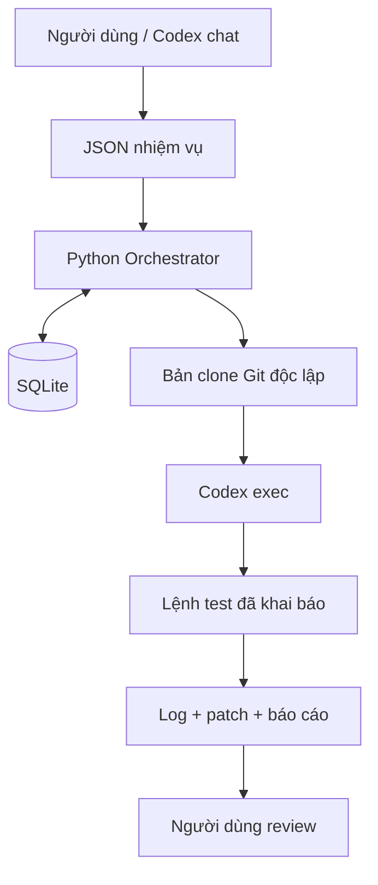

# Agent Harness cho Codex — Hướng dẫn sử dụng

Ngày thiết lập: 27/10/2026. Phiên bản local MVP 1.0.

## 1. Bạn đã được cài những gì?

Thư mục harness nằm tại `<repo>/agent-harness`; thay `<repo>` bằng repository bạn muốn thao tác.

Đây là lớp điều phối tùy chỉnh gọi Codex CLI đang có trên máy, không phải plugin chính thức có tên “Agent Harness”. Codex vốn đã có agent harness. Bản local bổ sung nhiệm vụ có trạng thái, bản Git độc lập, log, test và báo cáo. Không thay thế hoặc chỉnh sửa cấu hình tài khoản Codex toàn cục.

Thành phần:

| File/thư mục | Công dụng |
|---|---|
| `harness.ps1` | Điểm chạy PowerShell |
| `harness.py` | Bộ điều phối Python, chỉ dùng thư viện chuẩn |
| `AGENTS.md` | Chỉ dẫn để Codex thao tác lớp điều phối trong thư mục này |
| `job.example.json` | Mẫu giao việc cho dự án của bạn |
| `job.demo.json` | Nhiệm vụ review mẫu đã cấu hình |
| `demo-project` | Repository minh họa logic Void bằng dữ liệu giả |
| `data/harness.db` | SQLite lưu nhiệm vụ và trạng thái |
| `data/jobs/<ID>` | Bản code riêng, log và kết quả |
| `test_harness.py` | Kiểm tra logic của bộ điều phối bằng adapter giả |

Python hiện dùng runtime đi kèm Codex trong thư mục người dùng. Git và Codex được tìm qua PATH. Không cần pip install. Nếu runtime bị đổi sau cập nhật ứng dụng, thiết lập `HARNESS_PYTHON` như mục xử lý lỗi.

## 2. Kiến trúc và quyền thực thi



Mỗi lần chạy có một bản clone Git riêng, không dùng hardlink và đã bỏ remote origin. Clone chứa dữ liệu được commit, không mang theo thay đổi chưa commit, file ignored, môi trường ảo hay dependency chưa được quản lý bằng Git. Repository có submodule chưa được hỗ trợ.

Chế độ `review` dùng sandbox read-only. Chế độ `edit` dùng workspace-write. Approval policy là `never`: hành động cần nâng quyền sẽ không được tự động chấp thuận. Không sử dụng tùy chọn bỏ sandbox. Cấu hình model/tài khoản vẫn theo Codex CLI hiện có.

**Lệnh trong `tests` chạy trực tiếp trên Windows ngoài sandbox của Codex**, chỉ dùng lệnh và repository bạn tin cậy. Clone Git không phải máy ảo hay ranh giới an toàn để chạy mã không tin cậy. Mã nguồn hoặc nội dung Codex đọc có thể được gửi tới dịch vụ mô hình; “lưu trên máy” không có nghĩa là inference offline.

## 3. Bắt đầu bằng PowerShell

Mở PowerShell và chạy:

```powershell
cd <repo>\agent-harness
.\harness.ps1 doctor
.\harness.ps1 list
```

`doctor` hiển thị Python, Git, phiên bản Codex và trạng thái đăng nhập. Nếu chưa đăng nhập, chạy `codex login` và hoàn tất bước đăng nhập theo cửa sổ hướng dẫn. Harness không lưu mật khẩu hay sao chép token.

Chạy lại nhiệm vụ mẫu:

```powershell
$jobId = .\harness.ps1 submit .\job.demo.json
if ($LASTEXITCODE -eq 0) { .\harness.ps1 run $jobId }
.\harness.ps1 show $jobId
```

Đây là lần gọi mô hình thật, có sử dụng hạn mức của phương thức đăng nhập hiện tại. Không có cam kết miễn phí hoặc hạn mức vô hạn.

## 4. Dùng ngay trong Codex

Mở thư mục `<repo>\agent-harness` làm project trong Codex, tạo chat trong project đó rồi giao việc:

> Đọc HUONG_DAN.md, kiểm tra doctor và chạy job.demo.json bằng Agent Harness. Sau đó cho tôi biết trạng thái, test đã chạy và đường dẫn báo cáo.

Với một repository riêng:

> Dùng Agent Harness review repository Git tại D:\MyProject. Phân tích logic thay đổi spec và cập nhật OK/NG. Chỉ đọc, chưa sửa. Tạo job JSON, chạy và cho tôi xem báo cáo.

Codex đọc `AGENTS.md` trong project để biết các lệnh. Đây là tích hợp qua chỉ dẫn project và CLI, không tạo nút mới trong giao diện Codex. Trong chat khác, có thể yêu cầu Codex đọc đường dẫn tuyệt đối tới hướng dẫn này.

## 5. Cấu hình nhiệm vụ thật

Copy `job.example.json` thành `job.my-project.json`, chỉnh đường dẫn đến **gốc Git repository**. Repository cần có ít nhất một commit và không có thay đổi chưa commit hoặc file untracked. Không tự commit hay xóa dữ liệu chỉ để vượt qua kiểm tra; xem `git status` và quyết định lưu các thay đổi trước.

Ví dụ:

```json
{
  "repo": "D:\\MyProject",
  "mode": "edit",
  "task": "Sửa lỗi thay đổi spec nhưng kết quả OK/NG không cập nhật. Không thay đổi thuật toán đo void.",
  "acceptance": "Void 12%, spec 10% phải NG; spec 15% phải OK. Kiểm tra đúng quy tắc trường hợp bằng ngưỡng theo yêu cầu dự án. Giải thích file đã sửa.",
  "tests": [["dotnet", "test", "MyProject.sln", "--no-restore"]],
  "timeout_seconds": 900
}
```

Đường dẫn solution và lệnh test chỉ là ví dụ; sửa cho khớp dự án. `--no-restore` chỉ dùng khi dependency đã sẵn sàng trong môi trường clone. Với Python:

```json
"tests": [["{python}", "-B", "-m", "unittest", "discover", "-v"]]
```

`{python}` được thay bằng Python đang chạy harness. Mỗi lệnh là mảng đối số; không dùng chuỗi ghép bằng `&&`, pipe hoặc chèn câu lệnh shell. Nếu cần script, đưa đường dẫn script đã review thành đối số rõ ràng.

| Trường | Ý nghĩa |
|---|---|
| `repo` | Đường dẫn tuyệt đối tới repository Git |
| `mode` | `review` chỉ đọc; `edit` được sửa bản clone |
| `task` | Yêu cầu cụ thể |
| `acceptance` | Điều kiện cần đạt để người dùng review |
| `tests` | Danh sách lệnh chạy tuần tự sau khi Codex hoàn thành |
| `timeout_seconds` | 10–7200 giây, áp dụng riêng cho Codex và từng lệnh test |

`acceptance` là hướng dẫn cho agent và người review, không tự trở thành phép kiểm chứng. Cần thể hiện yêu cầu quan trọng bằng test thích hợp. Danh sách test rỗng không đồng nghĩa phần mềm đã được kiểm thử.

## 6. Đọc kết quả

```powershell
.\harness.ps1 list
.\harness.ps1 show ID_NHIEM_VU
```

| Trạng thái | Ý nghĩa |
|---|---|
| `queued` | Đã lưu, chưa chạy |
| `running` | Đang chạy hoặc bị dừng bất thường trước khi ghi kết quả |
| `needs_review` | Có sự kiện Codex hoàn tất, các lệnh test khai báo trả exit code 0; cần người xem lại |
| `failed` | Codex, Git, test, timeout hoặc xuất diff bị lỗi |
| `interrupted` | Người dùng Ctrl+C; harness đã yêu cầu dừng cây tiến trình |

Không có tự động “approved”, merge hoặc release. Trong `data/jobs/<ID>`:

- `answer.md`: câu trả lời cuối của Codex.
- `report.md`: trạng thái tổng hợp và commit gốc.
- `events.jsonl`: sự kiện Codex, có thể chứa usage tùy phiên bản CLI.
- `stderr.log`: lỗi và chẩn đoán.
- `test-N.stdout.log`, `test-N.stderr.log`: bằng chứng từng lệnh test.
- `changes.patch`: diff so với commit gốc, gồm file mới không bị Git ignore.
- `git-status.txt`: trạng thái Git bản clone.
- `workspace`: mã nguồn kết quả để mở và review.
- `prompt.txt`, `command.json`: yêu cầu và câu lệnh đã thực thi.

Không chia sẻ log công khai nếu chứa code, đường dẫn hoặc thông tin riêng. File ignored không có trong patch; bản clone vẫn là nơi kiểm tra kết quả đầy đủ. Một lệnh test exit 0 không chứng minh toàn bộ sản phẩm đúng, và agent có thể sửa cả test trong chế độ edit: luôn review diff của test.

## 7. Đưa thay đổi về dự án

Trước hết mở `answer.md`, `changes.patch` và log test. Chạy ứng dụng hoặc bộ test cần thiết trên bản clone. Sau khi chấp nhận thay đổi, có thể dùng Git để áp dụng patch vào repository gốc đang ở commit tương ứng:

```powershell
git -C D:\MyProject apply --check <repo>\agent-harness\data\jobs\ID_NHIEM_VU\changes.patch
git -C D:\MyProject apply <repo>\agent-harness\data\jobs\ID_NHIEM_VU\changes.patch
```

Nếu `--check` báo lỗi, dừng và review khác biệt; không ép ghi đè. Harness không tự thực hiện hai lệnh này. Sau khi áp dụng, chạy test lại trước khi commit/phát hành. Với sửa đổi ảnh X-ray, kiểm tra trên bộ dữ liệu chuẩn và không xem ví dụ Void giả là chứng nhận độ chính xác sản xuất.

## 8. Dừng và chạy lại

Ctrl+C trong terminal đang chạy để dừng. Timeout sẽ dừng cây tiến trình trên Windows và ghi trạng thái failed. Không hỗ trợ worker chạy nền hay tự khởi động cùng Windows.

```powershell
$newId = .\harness.ps1 retry ID_CU
if ($LASTEXITCODE -eq 0) { .\harness.ps1 run $newId }
```

`retry` tạo ID mới từ cùng yêu cầu, lấy HEAD hiện tại của repository gốc và bắt đầu lại; không tiếp nối hội thoại hay sửa đổi của lần cũ. Bản cũ được giữ nguyên để tra cứu.

Nếu mất điện hoặc đóng cưỡng bức terminal, trạng thái có thể vẫn là running. Kiểm tra Task Manager, bảo đảm tiến trình của nhiệm vụ đã dừng, rồi submit JSON thành nhiệm vụ mới. Bản v1 không tự khôi phục tác vụ running và không tự đoán tiến trình nào được phép đóng. Không sửa database thủ công để biến nhiệm vụ lỗi thành đạt.

## 9. Xử lý lỗi thường gặp

**PowerShell chặn script:** dùng Python trực tiếp, không cần đổi ExecutionPolicy toàn máy:

```powershell
& "$env:USERPROFILE\.cache\codex-runtimes\codex-primary-runtime\dependencies\python\python.exe" .\harness.py doctor
```

**Không tìm thấy Python:** cài/chọn Python 3.10+ của bạn, đặt biến cho cửa sổ hiện tại:

```powershell
$env:HARNESS_PYTHON = 'C:\Path\To\python.exe'
.\harness.ps1 doctor
```

**Không tìm thấy Codex:** kiểm tra `Get-Command codex`. Cần CLI đã được cài và có trong PATH. Cập nhật Codex có thể thay đổi cờ CLI; đối chiếu `codex exec --help`.

**Repository có thay đổi:** xem `git status`; commit những thay đổi cần đưa vào tác vụ hoặc chọn repository sạch khác. Harness không mang theo file chưa commit.

**Thiếu dependency:** clone không chứa virtualenv/node_modules hoặc package restore. Cấu hình môi trường dự án trước; chỉ thêm lệnh cài dependency đã hiểu và chấp nhận.

**Access denied / lỗi Git MSYS khi chạy trong sandbox lồng nhau:** chạy harness từ PowerShell thông thường, hoặc để Codex yêu cầu quyền phù hợp cho lệnh cụ thể. Không bỏ sandbox của agent để chữa lỗi tùy tiện.

**Hết hạn mức, lỗi mạng hoặc xác thực:** đọc stderr.log và events.jsonl, kiểm tra `codex login status`; chạy lại khi nguyên nhân đã được xử lý. Không có vòng retry vô hạn.

## 10. Worker nền trên Windows

Có thể cài worker xử lý hàng đợi Harness tuần tự mỗi khi tài khoản Windows đăng nhập:

```powershell
& .\install-worker-task.ps1
```

Worker chạy lệnh `worker`, kiểm tra job `queued` mỗi 30 giây, chỉ xử lý một job tại một thời điểm và ghi log tại `data/worker.log`. Có thể dừng trong Task Scheduler bằng task `Konoha-Agent-Harness-Worker` hoặc gỡ task bằng:

```powershell
Unregister-ScheduledTask -TaskName Konoha-Agent-Harness-Worker -Confirm:$false
```

Đây chỉ là worker cục bộ lúc người dùng đã đăng nhập. Nó không chạy khi PC tắt/ngủ, không được nối với hàng đợi các phòng ban trong app, và không tự duyệt, push, merge hay deploy.

## 11. Giới hạn và hướng mở rộng

Bản hiện tại là CLI có lưu trạng thái, một Codex worker cho mỗi lần run và worker hàng đợi cục bộ tùy chọn. Chưa có dashboard, QA agent độc lập, GitHub connector, kết nối với hàng đợi của app, tự merge/deploy hay tự hồi phục phiên.

Timeout là giới hạn thời gian, không phải giới hạn tiền hoặc token. Các test chạy ngoài sandbox và quyền model theo cấu hình Codex sẵn có; cần đánh giá lại nếu muốn triển khai nhiều người dùng.

Mở rộng hợp lý: dashboard chỉ đọc báo cáo → hàng đợi worker → kiểm tra độc lập → duyệt phát hành → GitHub. Chỉ thêm khi quy trình một dự án đã ổn định.

## 11. Kiểm tra và gỡ bỏ

Chạy test harness:

```powershell
& "$env:USERPROFILE\.cache\codex-runtimes\codex-primary-runtime\dependencies\python\python.exe" -m unittest discover -s . -v
```

Test harness dùng adapter giả cho đầu ra mô hình, có Git và SQLite thật. Kiểm tra end-to-end dùng `job.demo.json` mới gọi Codex thật. Xem `KIEM_TRA.md` để biết kết quả bàn giao.

Để gỡ: dừng task `Konoha-Agent-Harness-Worker` nếu đã cài, sao lưu `data` và các bản code cần giữ, rồi xóa đúng thư mục `agent-harness` trong repository bằng File Explorer. Không cần gỡ Codex hoặc xóa cấu hình tài khoản; harness không cài Windows service hay sửa PATH toàn máy.

## 12. Tài liệu chính thức

- [Codex: chọn lớp tích hợp harness](https://developers.openai.com/blog/codex-as-a-platform)
- [Chạy Codex không tương tác và JSON events](https://developers.openai.com/codex/noninteractive/)

Các lệnh triển khai được đối chiếu thêm với `codex exec --help` trên máy khi thiết lập.
